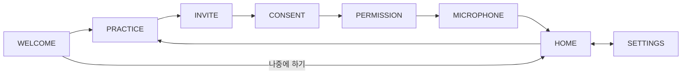

# 시작 화면 (여기콕 진입 화면)

앱의 런처 화면은 `ui/helper/HelperActivity`입니다. 모든 빌드(debug/release)에서 같은 화면이 열립니다.
이름: 앱은 여기콕, 캐릭터는 콕콕이, 화면 옆에 뜨는 버튼은 도움 버튼입니다.

## 흐름



| 페이지 | 내용 |
| --- | --- |
| WELCOME | 최초 안내. 안내를 아직 보지 않았을 때만 첫 화면입니다. "함께 연습하기"는 PRACTICE로 갑니다. |
| PRACTICE | 전체 화면 연습(가짜 설정 앱). 열기, 질문하기, 따라 누르기, 완료 4단계. 권한 허용, 서비스 시작, AI 요청은 하지 않습니다. 끝나면 INVITE로 갑니다. |
| INVITE | "예, 콕콕이 켜기"는 설정 이어가기, "한 번 더 연습하기"는 PRACTICE로 갑니다. |
| CONSENT | 화면 정보가 OpenAI로 전송된다는 동의. 동의를 저장한 뒤 다음 단계로 갑니다. |
| PERMISSION | 접근성 설정을 엽니다. 설정에서 돌아와 접근성이 켜져 있으면 자동으로 이어갑니다. |
| MICROPHONE | 마이크 허용(말로 대화하려면 필요). "나중에 하기"를 눌러도 콕콕이는 켜지고, "물어보기" 때 다시 요청합니다. |
| HOME | 콕콕이가 켜져 있는지 꺼져 있는지 보여 주고 "물어보기", "콕콕이 켜기", "다시 시도", "도우미 종료", "사용법 다시 연습하기"를 제공합니다. |
| SETTINGS | 음성 안내, 마이크(음성 대화 스위치 또는 허용), 알림 허용, 최초 안내 다시 보기. |

시스템 뒤로 가기와 "나중에 하기"는 WELCOME과 HOME을 제외한 모든 페이지에서 HOME으로 갑니다.
시스템 뒤로 가기는 WELCOME과 HOME에서만 화면을 닫습니다.

### 설정 체인

동의, 접근성, 마이크(선택) 순서입니다. 매 단계마다 저장된 설정을 다시 읽어 이미 끝난 단계는 건너뛰고,
모두 끝났으면 보이는 화면에서 MCP 서버를 시작한 뒤 도우미를 켜고 HOME으로 갑니다.
앱의 AI 연결(빌드에 포함된 OpenAI 키 `OPENAI_API_KEY`)이 없으면 서버를 시작하지 않고 HOME에서 안내만 보여 줍니다.

### 도우미 켜기와 끄기

- "물어보기"는 마이크 권한을 확인하고 실시간 음성 대화를 시작한 뒤 휴대폰 홈 화면을 엽니다. 도움 버튼은 대화하는 동안 보입니다.
- "도우미 종료"는 대화와 도움 버튼을 끝내고 MCP 서버를 멈춥니다. 도우미가 켜져 있으면 부팅할 때 서버가 시작됩니다.
- PRACTICE와 설정 다시 보기로 들어갈 때는 진행 중인 대화를 먼저 끝내고, HOME이 아닌 동안에는 도움 버튼을 숨깁니다.

### 연습의 음성 입력

연습은 기기 안 음성 인식만 씁니다(네트워크 인식으로 대체하지 않음). 기기에 없으면 마이크 버튼이 숨겨지고 글자 입력만 됩니다.
실시간 대화가 켜져 있는 동안에는 연습 음성 입력이 시작되지 않아, 마이크를 쓰는 곳은 항상 하나뿐입니다.

## 파일

경로: `app/src/main/kotlin/com/danielealbano/androidremotecontrolmcp/ui/helper/`

| 파일 | 역할 |
| --- | --- |
| HelperActivity.kt | 권한 요청, 시스템 화면 열기, 상태 보고, 도움 버튼 숨김 연결 |
| HelperEntryViewModel.kt | 설정, 서버, 접근성, 권한, 대화 상태를 하나의 `HelperEntryUiState`로 합치고 화면 이동 상태를 저장 |
| HelperSetupFlow.kt | 동의, 접근성, 마이크, 켜기로 이어지는 설정 체인 |
| HelperConversationControl.kt | 실시간 대화 시작, 종료, 활성 여부(화면이 필요한 것만) |
| HelperServerSwitch.kt | MCP 서버 시작과 종료 |
| HelperSettingsEditor.kt | 안내 본 여부, 음성, 음성 안내 설정 변경 |
| HelperEntryModel.kt | 화면 이동과 상태 계산(순수 로직) |
| HelperEntryScreen.kt, HelperEntryPages.kt, HelperEntrySetupPages.kt, HelperEntrySettingsPage.kt, HelperEntryParts.kt | Compose 화면 |
| HelperHomeStatus.kt, HelperMascotStateVisual.kt, HelperCharacter.kt | HOME 상태와 콕콕이 그림 |
| practice/ | 전체 화면 연습, 코치 카드, 질문 입력, 기기 안 음성 입력 |
| bubble/HelpButtonFace.kt, bubble/HelperRequestInput.kt | 도움 버튼 모양과 입력 화면(실제 패널과 연습이 공유) |
| HelperEntryActions.kt | 화면이 내보내는 사용자 동작 인터페이스 |

문구: `app/src/main/res/values/helper_*_strings.xml` (`entry_`, `helper_onboard_`, `helper_consent_`, `helper_mic_setup_`, `helper_home_`, `helper_practice_`, `helper_tour_`, `helper_voice_` 접두사).

## APK 만들기 (OpenAI 키 포함)

앱의 OpenAI 키는 저장소 루트의 `local.properties`(Git에서 제외됨)에 두거나 `OPENAI_API_KEY` 환경 변수로 넘깁니다.
키는 release와 debug 빌드 모두에 들어갑니다. 해커톤용 빌드이며 앱 스토어에 배포하지 않습니다.

```properties
OPENAI_API_KEY=여기에_키
```

그 뒤 `./gradlew :app:assembleGmsDebug`로 빌드하면 키가 빌드 시점에 앱에 들어갑니다.
이 파일과 키는 커밋하거나 GitHub에 올리지 마세요. 로그나 PR 설명에도 적지 않습니다.

## 검증

```sh
./gradlew :app:compileGmsDebugKotlin
./gradlew :app:testGmsDebugUnitTest --tests '*HelperEntryModelTest' --tests '*HelperEntryViewModelTest' --tests '*PracticeVoiceInputTest' --tests '*ExportedComponentsManifestTest'
./gradlew :app:ktlintCheck :app:detekt
```

### Manual QA Steps

- 첫 실행(사이드로드 APK, 제한된 설정 경로)에서 WELCOME, 연습 1~4, INVITE, CONSENT, 접근성을 거치고, 돌아오면 자동으로 이어지는지 확인합니다. 이어서 마이크 허용, 거부, 나중에 하기를 각각 확인합니다.
- 실시간 대화 중에 HOME에서 "사용법 다시 연습하기"를 누르면 대화가 끝나고, 연습의 마이크가 동작합니다.
- 질문 입력 단계에서 화면을 회전해도 단계와 입력한 글이 유지됩니다.
- 글자 크기 200%, 너비 320dp, 어두운 테마에서 모든 페이지를 확인합니다.
- TalkBack: 연습 배경은 건너뛰고, 코치 카드가 읽히며, 도움 버튼에 이름과 역할이 있고, 동의 내용이 순서대로 읽힙니다.
- 애니메이션 제거 설정을 켜면 HOME의 원이 정지합니다. 어두운 테마에서도 켜진 원은 밝게 보입니다.
- 삼성과 Pixel 런처에서 아이콘 마스크를 확인하고, 정보 화면이 열리는지 확인합니다.
